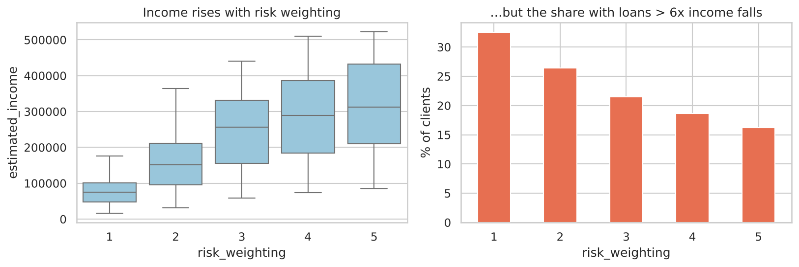

# Banking Risk Analytics & Customer Financial Behaviour

**Python · Pandas · PostgreSQL · Tableau**

An end-to-end analysis of **3,000 bank clients**, looking at loan exposure, deposits, customer segments and credit risk. It finds a **$618M funding gap** and **595 clients (19.8%) whose risk rating hides high leverage**, and turns these into data-backed recommendations.

🔗 **Live dashboard:** *[add your Tableau Public link here]*
📊 **Full write-up:** [`docs/insights_report.md`](docs/insights_report.md)


<!-- Replace with your Tableau screenshot / GIF after publishing -->

---

## Business problem

A bank needs to understand **where its money is lent, how well lending is funded by deposits, and which clients carry hidden risk**, so that credit, product and relationship teams can act. Questions answered:

1. How large is the loan book vs the deposit base?
2. Which customer groups hold the most exposure?
3. Does the bank's risk weighting capture affordability?
4. Does the loyalty programme reflect customer value?
5. Which segments should be targeted for growth, cross-sell or review?

## Data

| File | Contents |
|---|---|
| `data/raw/Banking.csv` | 3,000 client records × 25 columns: demographics, income, loans, deposits, credit cards, fee structure, loyalty tier, risk weighting |
| `data/raw/gender.csv`, `banking_relationships.csv`, `investment_advisors.csv` | Lookup tables joined via `GenderId`, `BRId`, `IAId` |
| `data/processed/banking_clean.csv` | Cleaned, joined table with 14 engineered features (the input for Tableau) |

## Approach

```
Raw CSVs → Python (cleaning, data quality, feature engineering) → banking_clean.csv → Tableau dashboard
        ↘ PostgreSQL (star-style schema, analysis view, 18 business queries)
```

1. **Data quality** (`notebooks/01`): types, missing values, duplicates, key integrity, zero balances, outliers. Found that **59 Client IDs are reused by different people**, so I added a surrogate key. A distinct count of Client ID would undercount clients by 60.
2. **Feature engineering:** total loan and deposit, net position, loan-to-deposit, **loan-to-income**, income/age/tenure bands, estimated fee revenue, product-mix segments, and an **under-rated risk flag**.
3. **SQL analysis** (`sql/`): normalised schema with constraints and foreign keys, staging → clean load, an analysis view, and 18 queries using CTEs, window functions (`RANK`, `ROW_NUMBER`, `LAG`, running totals), `PERCENTILE_CONT` and conditional aggregation.
4. **EDA, segmentation and statistics** (`notebooks/02`): segment profiling, Spearman correlation, Kruskal–Wallis tests.
5. **Tableau dashboard:** 3 pages (Executive Overview, Loan & Risk, Segments & Loyalty) with KPI cards, filters, a parameter and dashboard actions. See [`docs/tableau_build_guide.md`](docs/tableau_build_guide.md).

## Key insights

| # | Insight |
|---|---|
| 1 | **Loans exceed deposits:** $4.38B vs $3.77B (LDR 1.16), a **$618M funding gap** |
| 2 | **Risk Weighting tracks exposure size, not affordability:** 32.5% of the lowest-risk clients have loans > 6× income, vs 16.3% of the highest-risk clients |
| 3 | **595 clients (19.8%)** are rated low-risk but are highly leveraged. They hold **25% of bank loans** at a median of 9.1× income |
| 4 | **Loyalty tiers don't reflect value:** no significant difference in deposits, income or tenure across tiers (Kruskal–Wallis p > 0.15); Platinum has the lowest median deposits |
| 5 | **Private Bank** holds 45% of clients and of the loan book; Business Lending is 59% of all loans |
| 6 | **Borrower-heavy** clients (491) hold $973M of loans but only $254M of deposits, the main driver of the funding gap |



## Recommendations

- Add a **loan-to-income check** to risk scoring and review the 595 flagged clients, prioritised by advisor.
- **Cross-sell deposits** to Borrower-heavy clients; offer **lending and investment** to Savers ($803M of deposits).
- **Rebuild loyalty tiers** on deposits, product holding and tenure.
- Fix **Client ID integrity** at source and investigate the missing 1997–1998 cohort.

## Repository structure

```
├── data/
│   ├── raw/                     # original CSVs
│   └── processed/               # banking_clean.csv (Tableau input)
├── notebooks/
│   ├── 01_data_cleaning_feature_engineering.ipynb
│   └── 02_eda_segmentation_risk.ipynb
├── sql/
│   ├── 01_schema.sql            # tables, constraints, analysis view
│   ├── 02_load_data.sql         # \copy + staging → clients
│   ├── 03_analysis_queries.sql  # 18 business questions
│   └── 03_query_results.txt     # output of the queries
├── tableau/                     # Banking_Risk_Dashboard.twbx (add after building)
├── images/                      # charts + dashboard screenshots
├── docs/
│   ├── insights_report.md
│   └── tableau_build_guide.md
└── requirements.txt
```

## How to run

```bash
pip install -r requirements.txt
jupyter notebook notebooks/          # run 01, then 02

# PostgreSQL (run from the repo root)
createdb banking
psql -d banking -f sql/01_schema.sql
psql -d banking -f sql/02_load_data.sql
psql -d banking -f sql/03_analysis_queries.sql
```

## Limitations

This is a public sample dataset with no loan-default outcome, so risk is assessed through exposure and affordability proxies. Processing-fee rates (5% / 3% / 1%) and the 6× loan-to-income threshold are stated assumptions.

## Author

**Soham Ghosh**, B.E. Printing & Packaging Engineering, Jadavpur University
[LinkedIn](https://www.linkedin.com/in/soham-ghosh-846546282/) · [GitHub](https://github.com/Soham29Ghosh)
